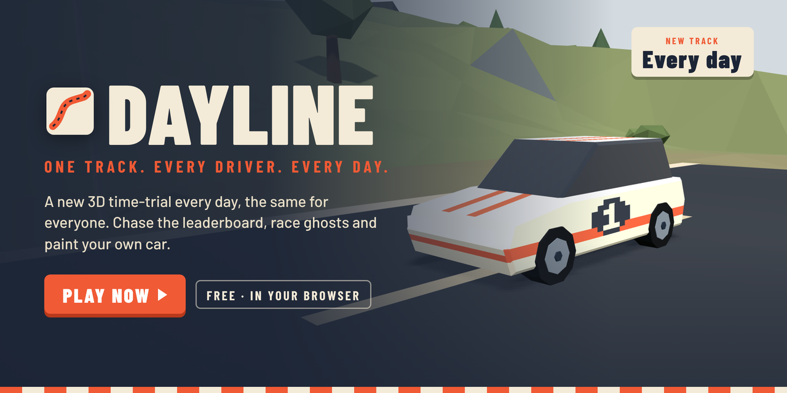

<h1 align="center">Dayline</h1>

<b>A new 3D time-trial every day, the same for everyone.</b> Chase the leaderboard, race ghosts and paint your own car.

<a href="https://dayline-game.github.io/Dayline/"><b>▶ PLAY NOW</b></a> &nbsp;·&nbsp; Free &nbsp;·&nbsp; In your browser &nbsp;·&nbsp; No install

---

## How it works
- **One track a day.** Every driver gets the same hilly low-poly course, generated from the date.
- **Race the world.** Daily and all-time leaderboards, with ghosts of other drivers' best runs.
- **Make it yours.** Paint your car in the pixel livery editor, earn coins and spend them in the shop.
- **Fair times.** Runs are re-checked on the server (checkpoints, speed and timing).

## Controls
| | Keys |
|---|---|
| Steer | ← → or A D |
| Throttle / brake | ↑ ↓ or W S |
| Handbrake | Space |
| Reset to checkpoint | R |
| Change camera | C |

## Tech
Three.js (flat-shaded low-poly), fixed 120 Hz physics with interpolated rendering, deterministic daily seed. Hosted on GitHub Pages; leaderboard and accounts on a free Supabase project. Set `apiBase` in `config.js` to connect your own; without it progress is saved locally in the browser.
